 

&nbsp;

&nbsp;

---

## ☕ About Me

| | |
|:---:|:---|
| 🌍 | Based in **Indonesia** |
| 💼 | **Software Engineering Student** — Python |
| 📐 | Currently learning **Javascript and C** |
| 🛠️ | Backend when needed — **Python** |
| 🐧 | Runs **Linux**, lives in **Vim** |
| 🎵 | Lo-fi playlists while shipping code |
| ☕ | Powered by coffee at sunrise |
| ⚡ | Fun fact: I debug faster after a cold one... allegedly |

---

## 🛠️ Tech Stack

**Languages** 

 

**Frontend** 

 

**Backend & Tools** 

---

## 📊 GitHub Stats

&nbsp;&nbsp;

<!--  -->

---

## 🐍 Contribution Snake

<picture>
  <source media="(prefers-color-scheme: dark)" srcset="https://raw.githubusercontent.com/frz013/frz013/output/pacman-contribution-graph-dark.svg">
  <source media="(prefers-color-scheme: light)" srcset="https://raw.githubusercontent.com/frz013/frz013/output/pacman-contribution-graph.svg">
  
</picture>

---

*"Code is like humor. When you have to explain it, it's bad."* — Cory House

 

